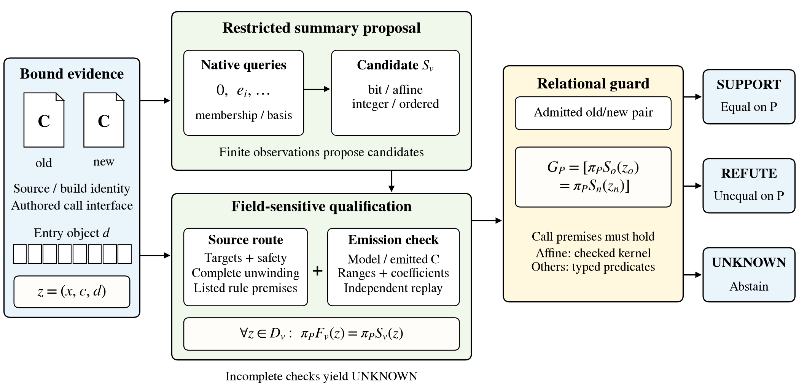

# RelGuard

RelGuard constructs source-checked state models and observation-specific relational guards. Candidate models are inferred from native observations, checked against source obligations, and used to generate executable guards. Affine guards include independently replayable elimination certificates.

[中文说明](README.zh-CN.md) · [Code guide](docs/implementation.md) · [Data](docs/data.md) · [Source checking](docs/source_checks.md)

## Run

Use Python 3.12 or later. From the repository root:

```sh
python -m pip install -r requirements.txt
python reproduce.py
```

The second command verifies the reference files, replays both saved studies, regenerates four figures and two tables, and exports an example CRC guard and relational kernel. Results appear in `build/`.

Run the tests:

```sh
python -m unittest discover -s tests -v
```

## Code layout

```text
scguard/
  models/       writer projections, affine states, integer and ordered models
  inference/    active writer queries and fitting from saved native observations
  checks/       independent model, emission, certificate and source-field checks
  source/       CRC composition and arithmetic source obligations
  codegen/      checked integer-prefix emission
  plotting/     current architecture figures, experiment plots and table previews
  core.py       public model and guard interface
  reference.py  reference-data readers and integrity checks
  replay.py     saved-result verification
  data/         reference models, protocols and execution records
tests/          regression and inference checks
examples/       executable API example
assets/         rendered paper figures and tables
reproduce.py    complete saved-result and figure reproduction
```

Each function has one current implementation. The code uses package-relative imports. Historical experiment runners and earlier alternative implementations are kept in the original project archive.

## Commands

```sh
python -m scguard --help
python -m scguard verify-data
python -m scguard replay --cohort all --output build/replay.json
python -m scguard infer --task miniz-3.1.0-crc32 --output build/crc-model.json
python -m scguard kernel --left miniz-3.1.0-crc32 --right miniz-3.1.1-crc32 --observer return --output build/crc-kernel.json
python -m scguard export --left miniz-3.1.0-adler32 --right miniz-3.1.1-adler32 --output build/adler-guard.c
python -m scguard export --cohort writer --left libgrapheme-2.0.1 --right libgrapheme-2.0.2 --output build/writer-guard.c
python -m scguard harness --task miniz-3.1.0-crc32 --route crc-step --output build/crc-step.c
python -m scguard figures --output build/figures
python -m examples.quickstart
```

`infer` reconstructs a candidate from the bundled cross-family training observations. Writer inference accepts an oracle callback through `scguard.inference.active.learn_writer`. Candidate fitting and source admission are separate operations; the inference command reports both explicitly.

## Reference results

| Study | Valid requests | SUPPORT | REFUTE | Invalid controls |
| --- | ---: | ---: | ---: | ---: |
| Writer, typed policy | 122,880 | 72,162 | 50,718 | 32 UNKNOWN |
| Cross-family, completed route | 49,896 | 13,076 | 36,820 | 32 UNKNOWN |

The replay also checks the writer comparison policies and their incorrect determinate results, the intermediate cross-family outcomes, and 2,592 affine certificates. Its model predictions and saved compiled-guard answers are compared with native O0/O2 outputs. The typed writer policy provides 4.8 times the determinate coverage of whole-entry identity.

## Figures and environment



The current figure implementation is `scguard/plotting/figures.py`. It preserves the author's adjusted equality panel and straight connectors. Text and box borders are black. Editable PDF/SVG figures and TeX tables are included in `assets/`.

The bundled workflow and `reproduce.py` run saved-data checks. New C source verification needs the recorded upstream sources and CBMC/ESBMC environment; see [Source checking](docs/source_checks.md). The data include fixed source identifiers, assumptions and checker flags.

## Notices

No license has been selected for the project's own code. Third-party font notices are retained in [NOTICE.md](NOTICE.md) and `third_party/`.
